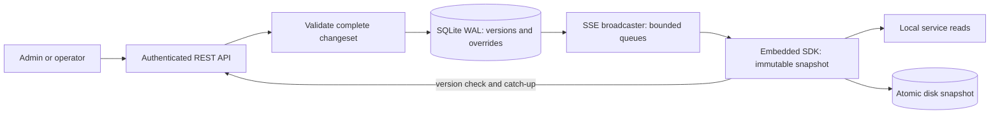

# Case Study 2 — Design Note

## Architecture and consistency

The Java SDK serves reads from an immutable in-process `ConfigSnapshot`. Resolution checks SHIFT, OFFICE, CLIENT and GLOBAL overrides, then the definition DEFAULT. `explain()` reports the actual source, including DEFAULT. A caller captures one snapshot before reading related keys. The server serializes writes, validates the complete changeset, commits it in SQLite WAL with `synchronous=FULL`, then sends its version over SSE. A one-second version check and ordered REST replay heal missed events. Connected clients target visibility within five seconds; during an outage, they remain available using their last good memory or disk snapshot, with no finite staleness bound.



The SDK keeps the complete authorized tenant configuration in memory; evicting an individual setting could break offline reads. It replaces old snapshot objects after an atomic pointer swap, while the JVM reclaims them when readers release their references. SSE queues have a 100-event bound; a slow subscriber is disconnected and recovers from the versioned API. One server and one SQLite writer keep ordering simple but limit horizontal scale.

## Hardest flow: rollback across scopes

Rollback reconstructs the target override state by replaying versioned changes, including canary promotion and earlier rollbacks. It computes a preview diff where `null` means an override will be removed. Commit holds the writer lock, replaces all effective overrides in one SQLite transaction, and appends exactly one new version. Each subscriber receives only its own tenant's replacement snapshot. The SDK swaps that snapshot as one unit, restoring parent inheritance without mixed scope states.

```mermaid
sequenceDiagram
    participant Admin
    participant API
    participant DB as SQLite WAL
    participant SSE
    participant SDK
    Admin->>API: POST rollback(targetVersion)
    API->>DB: Read history and reconstruct target
    API->>DB: One transaction: replace overrides + append version N
    DB-->>API: Commit N
    API->>SSE: Tenant-filtered replacement at N
    SSE-->>SDK: Delta N
    SDK->>SDK: Build snapshot; atomic pointer swap
    API-->>Admin: Diff and committedVersion N
```

## Failure modes

| Failure | Caller sees | Recovery |
|---|---|---|
| Invalid value in a changeset | HTTP 400; no version advances | Correct and resubmit the whole changeset |
| Server crash after acknowledged commit | SDK continues local reads | WAL recovers committed data; clients replay missed versions |
| Lost, duplicate or out-of-order delta | Last good snapshot remains available | Ignore old versions; fetch missing ordered deltas |
| 500 simultaneous reconnects | Some clients briefly serve stale snapshots | Decorrelated jitter spreads retries; delta replay catches up |
| Slow SSE consumer | Stream is closed | Bounded queue protects server; client reconnects and catches up |
| Network partition at cold boot | Disk-cached values remain readable | SDK refreshes when the server returns |

The repository contains unit, concurrency, fault-injection, isolation and benchmark tests. `./mvnw test` and `docker compose up --build` are the local verification and startup commands. Measured latency and machine context are recorded in the README and Maven logs.
